# Fortschritt: Umbau von HoloScan nach `docs/SPEC.md`

Der Umbau läuft auf dem Branch `claude/trusting-ramanujan-rxy6ep`. Veröffentlicht wird erst, wenn der neue Scanner fertig ist (siehe „Freigabe“).

## M1 Fundament – erledigt (13.10.2026)

### Bestehende Nutzerdaten bleiben erhalten
- Die App läuft weiter unter derselben Adresse (GitHub Pages). Damit bleiben IndexedDB und Service Worker dieselben.
- Beim ersten Start übernimmt `src/db/migrate.ts` aus der alten Datenbank `holoscan`:
  - Sammlung, Merkliste und Preisalarme
  - eigene Scan-Fotos
  - Scan-Verlauf, eigene Preisverläufe und Wertverlauf
  - Einstellungen, auch einen eingetragenen OpenRouter-Schlüssel
- Die alte Datenbank wird nur gelesen und nie verändert.
- Die Übernahme läuft genau einmal und ist idempotent. Unter „Einstellungen → Erneut prüfen“ lässt sie sich erneut anstoßen und ergänzt dann nur, was fehlt.
- „Alles löschen“ holt die alten Daten nicht zurück.
- Der neue Service Worker liegt wieder unter `sw.js` und übernimmt den alten sofort.
- Die Caches für Bildmodell, Bibliotheken und API behalten ihre Namen. Das ca. 30 MB große Bildmodell muss deshalb nicht neu geladen werden.
- Backups der alten Version (JSON v1) lassen sich importieren.

### Neu
- **Design „Die Vitrine“**:
  - samtschwarzer Hintergrund mit Holo-Akzent
  - Schriften Unbounded, Figtree und JetBrains Mono, selbst gehostet
  - Gewinn und Verlust immer mit ▲/▼
- **Karte als Objekt**:
  - 3D-Kippen per Finger oder Gyroskop, auf iOS nach einem Tipp
  - Holo-Glanz je nach Seltenheit
  - Antippen dreht die Karte zum **Kurszettel**: Trendpreis, Kursverlauf, Ø 1/7/30 Tage, Tiefstpreis, Einstand, Gewinn
  - `prefers-reduced-motion` schaltet Kippen und Glanz ab
- **Drei Orte**:
  - Scanner als Startbildschirm mit Sammlungswert und Tagesänderung
  - Binder: vom Scanner nach oben wischen oder auf den Knopf tippen
  - Karte: als Ansicht über allem
  - Zurück geht per Wischen nach unten oder per Knopf.
- **Binder**:
  - 3×3-Taschen, seitlich blättern
  - Mengen-Badge, wenn mehrere Posten dieselbe Karte betreffen
  - Ränder glühen grün oder rot je nach Entwicklung seit dem Kauf
  - Depot-Leiste mit Gesamtwert, Investiert und Gewinn in € und %
  - Sortieren nach Wert, Gewinn, Set oder „Zuletzt hinzugefügt“
  - Filtern nach Sprache, Set, Seltenheit, im Plus oder im Minus
  - Suche über Name und Nummer
- **Depot**:
  - Wertverlauf, Top 5 und Flop 5 seit dem Kauf
  - Karten ohne Preis werden separat gezählt und nicht als 0 € gewertet
- **Posten**:
  - Kaufpreis pro Stück, Herkunft (Kauf, Booster, Tausch, Geschenk), Kaufdatum, Notiz
  - Booster-Rechner: Packpreis ÷ Karten
  - Jede Aktion lässt sich 5 Sekunden lang rückgängig machen.
  - Geld wird durchgehend in ganzen Cent gespeichert.
- **Zustand**: Leiste M, NM, EX, GD, LP, PL, PO. Gedrückt halten zeigt eine Kurzerklärung.
- Kauf-Check, Cardmarket-Links je Zustand und Merkliste mit Preisalarm aus der alten Version bleiben erhalten.
- **Sicherheit**:
  - Der Backup-Import prüft jeden Eintrag streng und schreibt alles in einer Transaktion. Ein kaputtes Backup kann nichts mehr löschen und keinen Code einschleusen.
  - Kein API-Schlüssel steckt mehr im ausgelieferten Code.

### Daten-Pipeline
- Die erzeugten Daten liegen im Branch `data` als einzelner Commit, der ersetzt wird. Er wird nur gepusht, wenn sich etwas geändert hat.
- Damit ist der Fehler behoben, durch den der tägliche Lauf das Montags-Update von Karten- und Bildindex sofort wieder überschrieb.
- **Neu: tägliche Preis-Historie** aus Cardmarkets offiziellem Preis-Guide (`scripts/build-price-history.mjs`):
  - rund 80.000 Produkte, aufgeteilt auf 512 Dateien
  - ab 90 Tagen ein Wert pro Woche
  - Der Kursverlauf beginnt mit dem ersten Lauf und wächst mit jedem Tag.
- Bei jedem Push laufen Lint, Typecheck, Unit-Tests, Build und Browser-Tests. Veröffentlicht wird nur vom Standard-Branch.

### Tests
- `npm test`: 23 Unit-Tests
  - Übernahme der alten Daten, geschrieben mit dem **originalen** alten Speichermodul
  - Bewertung und Depot
  - Binder
  - Backup und Import
  - Preis-Historie: Pipeline und App müssen dasselbe Format lesen
- `npm run e2e`: 4 Browser-Tests
  - **Update-Test**: Die alte App läuft mit ihrem Service Worker und speichert Karten. Dann wird am selben Origin die neue App ausgeliefert. Geprüft wird, dass die Sammlung übernommen ist, die alte Datenbank unverändert bleibt und es keine doppelte Übernahme gibt.
  - Smoke-Tests: Suche → Karte → Kurszettel → Sammlung → Binder → Depot, Rückgängig, Backup
  - Jeder Test prüft außerdem, dass nichts über den Bildschirmrand ragt.

### Screenshots (Pixel 7)
Kartenbilder sind in den Tests Platzhalter, weil die TCGdex-Antworten aus festen Testdaten kommen.

| | |
|---|---|
| 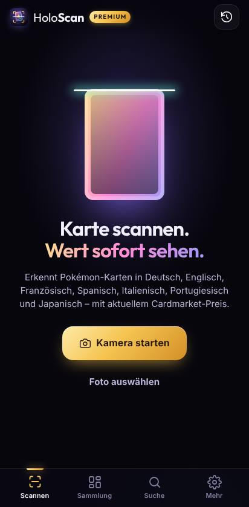 | 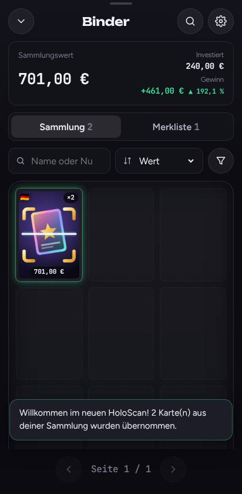 |
| 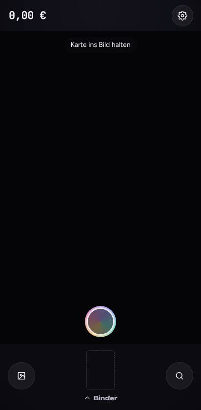 | 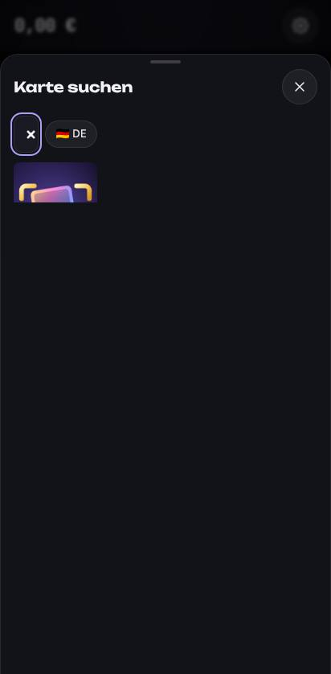 |
| 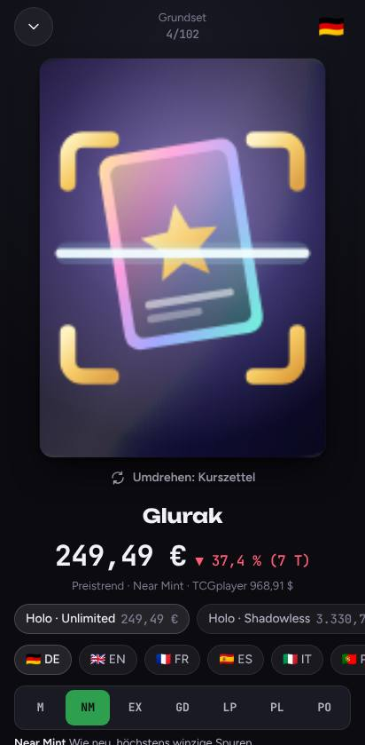 | 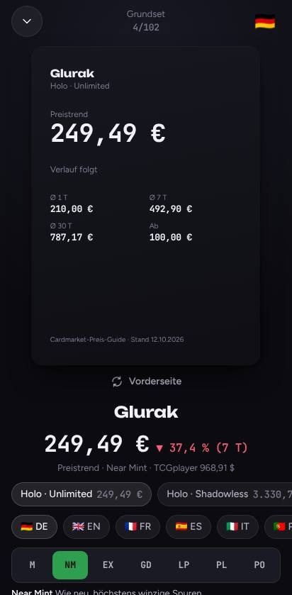 |
| 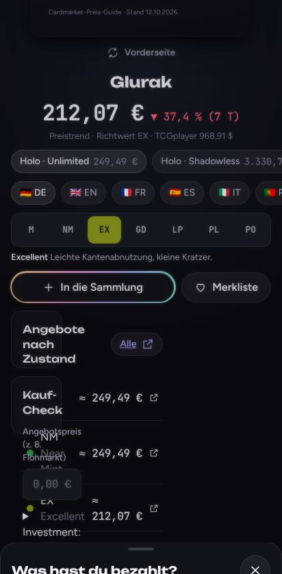 | 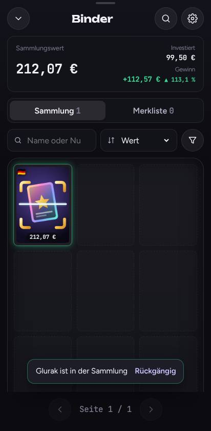 |
| 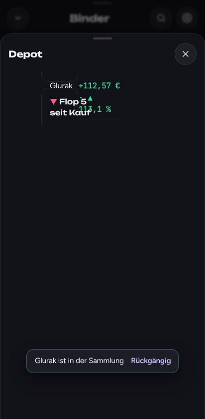 | 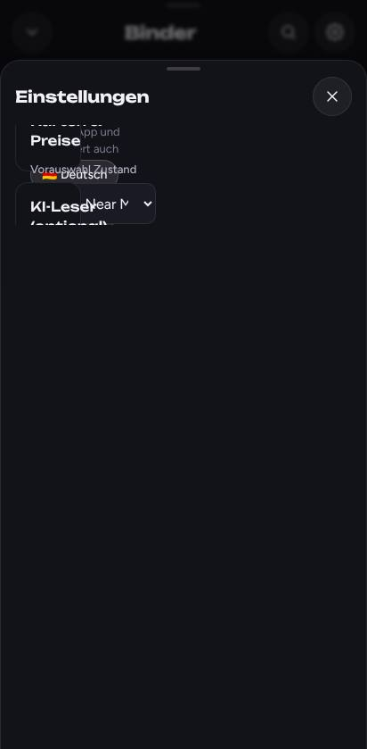 |

### Kennzahlen
- App-Bundle: 175 KB gzip (Budget laut Spec: 400 KB)
- Vorab-Cache: 0,95 MB

## M2 Galerie-Scan, M3 Live-Scan, M4 Fallbacks, M5 Feinschliff – erledigt (13.10.2026)

### Erkennung
Neu in `src/scan/`. Das Finden der Karten im Bild und die Bildsuche laufen in einem Web Worker, die Oberfläche bleibt flüssig.

- **Mehrere Karten pro Bild** (bis 9):
  - Flächen im Kantenbild werden auf das Kartenformat geprüft.
  - Eine Binderseite wird in ein Raster geteilt.
  - Ob eine Teilung stimmt, prüft die Bildsuche gegen. Füllt eine Karte das ganze Bild, greift die Kantensuche der ersten Version.
- **Bildsuche** mit dem bestehenden DINOv2-Modell:
  - engere Ausschnitte für Toploader, notfalls um 180° gedreht
  - Gegenstände ohne Ähnlichkeit zu einer Karte werden verworfen
- **Texterkennung nur bei Bedarf**, etwa bei Nachdrucken mit gleichem Motiv oder wenn die Sprache am Bild unklar ist.
- **„Sicher“ oder „nachfragen“:** Ist die Erkennung unsicher, bietet die App höchstens 3 Vorschläge oder die Suche an.
- **KI-Leser (M4):**
  - Gemini mit eigenem Schlüssel
  - Modell-Kette aus der Modell-Liste der API, keine fest eingebauten Namen
  - Tageszähler je Modell mit Neustart nach pazifischer Zeit, änderbare Limits, bei 429 das nächste Modell
  - Ein Ergebnis zählt nur, wenn Set und Nummer im Katalog passen.
  - Ein bestehender OpenRouter-Schlüssel funktioniert weiter.

### Kalibrierung
Gemessen mit `scripts/calib/` an künstlichen Handyfotos aus 120 echten Karten: Schräglage, Spiegelung, Hülle, Finger, Unschärfe, Binderseiten, verstreute Karten; 3 Schwierigkeitsstufen.

| Art | Karten | gefunden | sicher | davon falsch | nachfragen | Ø Zeit je Bild |
|---|---|---|---|---|---|---|
| Einzelkarte | 72 | 100 % | 72 % | **0** | 28 % | 2,8 s |
| Binderseite (9 Karten) | 27 | 85 % | 61 % | **0** | 39 % | 26 s |
| verstreute Karten | 17 | 53 % | 56 % | **0** | 44 % | 4,9 s |

Ziel der Spec erreicht: **null falsch-sichere Treffer.** Gegenüber dem ersten Lauf ist die Quote der sicheren Treffer höher (Einzelkarte 57 % → 72 %), die Fehlalarme sind von 19 auf 0 gesunken und die Zeit pro Einzelkarte von 4,2 auf 2,8 s.

Grenzen:
- Karten müssen ganz im Bild liegen und dürfen sich nicht überlappen.
- Die Schwellen sollten mit echten Fotos nachkalibriert werden.

### Galerie, Stapel, Triage (M2)
- Beliebig viele Fotos auf einmal. Die Warteschlange und der Stapel überstehen einen Neustart der App.
- Fortschritt als Ring am Stapel.
- **Triage:**
  - rechts = Sammlung, danach nur die Kaufpreis-Frage
  - links = verwerfen
  - oben = korrigieren: andere Karte, Sprache oder Variante
  - Jede Geste hat auch einen Knopf; Rückgängig steht 5 Sekunden bereit.
- Ohne Kartenbild in der Datenbank wird das eigene Foto gespeichert.
- Offline lässt sich eine Karte in die Sammlung legen; der Preis folgt, sobald wieder Netz da ist.

### Live-Scan (M3)
- Rückkamera mit 1080p. Etwa 8 Vorschaubilder pro Sekunde, die Karten werden umrandet.
- **Auslösen** nach 5 ruhigen Bildern (unter 6 px Bewegung bei 720p) und ausreichender Schärfe. Zusätzlich gibt es einen Auslöse-Knopf.
- **Doppel-Schutz:**
  - Dieselbe Karte, die im Bild bleibt, wird nicht erneut erkannt.
  - Kommt eine gleiche Karte dazu, fragt die App: „Nochmal hinzufügen?“
- Die erkannten Karten fliegen aus dem Livebild auf den Stapel, mit Haptik.
- Taschenlampe; Hinweis „leicht kippen“ bei Spiegelung.
- Die Kamera ist aus, solange Binder, Karte, Triage oder Einstellungen offen sind oder die App im Hintergrund läuft.
- Der frühere Fehler, bei dem die Kamera doppelt geöffnet wurde und die LED anblieb, ist behoben.

### Feinschliff (M5)
- Knopf „App installieren“ in den Einstellungen, Hinweis für iOS.
- Der Fokus bleibt in Blättern (Tab läuft im Kreis), Escape schließt sie.
- Sammel-Sprachen steuern die vorgeladenen Indexe und die Suchsprachen.
- Eine Fehlergrenze je Bereich verhindert, dass ein Fehler die ganze App leert.

### Tests
- `npm test`: 36 Unit-Tests. Neu sind Kartensuche (einzeln, verstreut, Binderseite gerade/schräg, leerer Grund), Auslöse-Logik und Doppel-Schutz sowie der KI-Client (Tageswechsel, Modell-Kette).
- `npm run e2e`: 7 Browser-Tests. Neu sind der Galerie-Scan mit **echter Erkennung** (Einzelkarte und Binderseite) und die Live-Kamera mit Chromes Test-Kamera: Sie startet, erfindet keine Karte und schaltet sich ab, wenn der Binder offen ist.

| | |
|---|---|
| 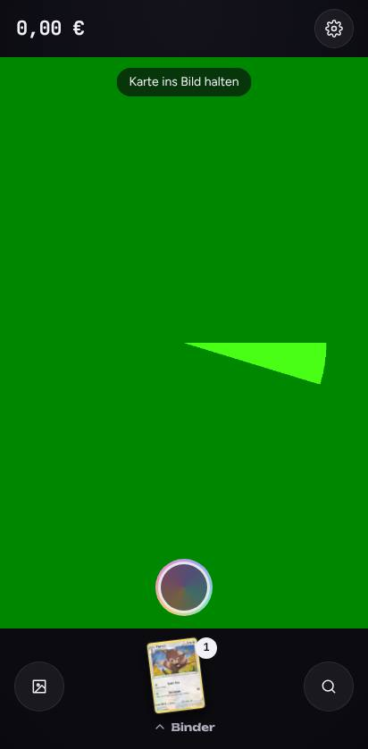 | 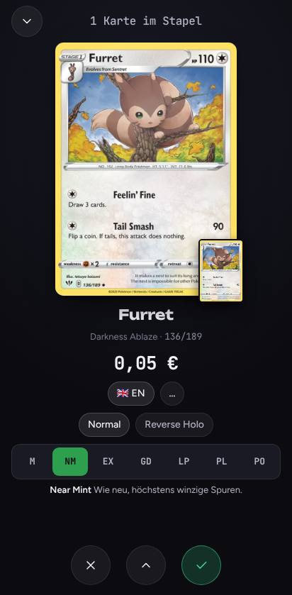 |

## Freigabe
Der neue Stand hat jetzt einen eigenen Scanner und ersetzt die alte App vollständig. Für die Veröffentlichung muss dieser Branch in den Standard-Branch `ccr-a44fa02f-ylk895` gemergt werden. Danach baut und veröffentlicht der Workflow automatisch. Beim nächsten Öffnen übernimmt die App die Sammlungen der Nutzer.

Vor dem Mergen empfohlen:
1. Einmal am eigenen Handy testen, und zwar mit der Vorschau des Branches oder lokal per `npm run build && npx vite preview --host`.
2. Den OpenRouter-Schlüssel im GitHub-Secret `OPENROUTER_KEY` widerrufen und das Secret löschen. Er wird nicht mehr gebraucht.

## Offene Punkte
- Schwellen mit echten Fotos nachkalibrieren. Dafür eigene Fotos nach `.cache/calib/scenes/` legen und in `truth.json` eintragen.
- Nutzungsbedingungen des Cardmarket-Preis-Guides klären (siehe `FINDINGS.md`).
- Englische Oberfläche ist vorbereitet, aber noch nicht umgesetzt.
- Binderseiten mit 9 Karten brauchen etwa 25 s. Schneller ginge es mit mehreren Threads, das erlaubt GitHub Pages aber nicht (COOP/COEP).
